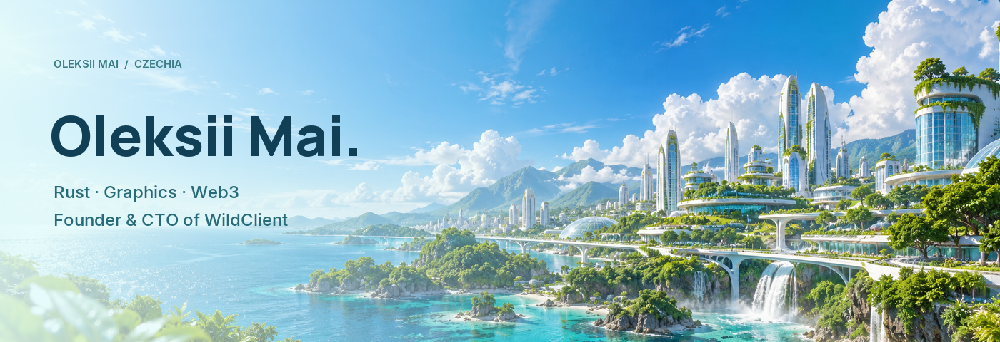

I'm Oleksii Mai, a Rust engineer, Web3 quant and shader developer based in Czechia. I founded WildClient in 2020 and returned to the project in 2026 after two years away.

### Building

**SynapseHFT** — a private Rust project focused on high-frequency trading research, prediction markets and on-chain systems.

**[WildClient](https://wildclient.org)** — a Minecraft client founded in 2020 and released in 2021. Wild has more than 100,000 users.

I also work on confidential professional projects in the field of mathematical analysis.

### Other projects

**SolGate** — Rust research into Solana market structure and infrastructure.  
**Pixie** — a real-time desktop AI companion with on-device speech and GPU visuals.  
**Ústí Live** — a local news workflow with source gathering, AI drafting and human moderation.  
**PrahaLive & Quark Editor** — AI-assisted editorial tools for Telegram.  
**QuarkAI** — early machine-learning experiments in crypto price prediction.

### Background

I started in game development with Unity and Unreal Engine 4, with projects including Rebel of Hero, Heganons, Shoot or Die, Color Switch and Whisper of Sea. In 2020 I began learning to build Minecraft clients; in 2022 I rewrote Wild from scratch and moved from Forge to MCP. Alongside development, I taught at an IT school for two years. After leaving Wild in 2024, I started the unfinished Ethereal project and later worked for several months as a developer at Melonity. I returned to Wild in 2026.

### Tools

**Languages:** Rust, Java, C#, Python  
**Graphics:** GLSL, WGSL, HLSL, wgpu  
**Game development and ML:** Unity, Unreal Engine 4, TensorFlow

[Portfolio](https://alekseimai.github.io) · [Telegram](https://t.me/lichoday) · [Instagram](https://instagram.com/lichoday)
