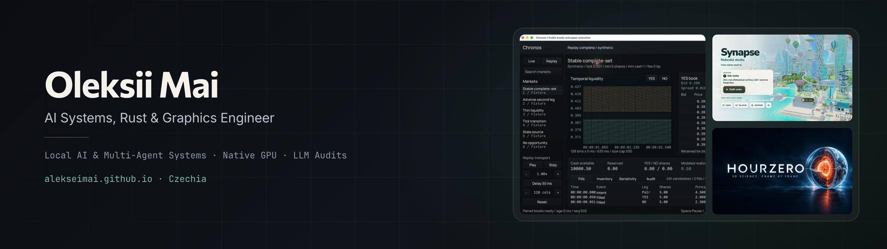

  

# Oleksii Mai

AI systems, Rust, and graphics engineer based in Czechia. I architect local-first AI software, multi-agent engineering pipelines, deterministic native desktop applications, interactive 3D worlds, and frontier-LLM security audits.

### Applied AI & Agentic Engineering

- **Multi-Agent Orchestration & Verification** — Designing multi-model agent pipelines, automated cross-verification harnesses, and browser/UI verification loops that ship production native and web systems at high precision.
- **Local AI Detection & Interpretability (`DetectorScope`)** — Building kernel-sandboxed, zero-network neural text analysis studios combining custom Czech legal classifiers (`cs-legal-v2`), sliding token-window scoring, and **Google DeepMind `DetectorScope`** integration for feature-level logit attribution and activating-token inspection (**neOpisuj**).
- **Real-Time Atmospheric & Optical GPU Shaders** — Authoring physically inspired rendering pipelines (exponential height fog, Rayleigh-Mie dawn scattering, volumetric nebula raymarching, spectral dielectric refraction, and fluid cloud advection) — live interactive simulations available on [alekseimai.github.io](https://alekseimai.github.io/?scene=1).
- **Frontier LLM Evaluation & Forensics** — Deep empirical auditing of AI coding agents, reasoning-trace behavior, token ceilings, local telemetry pipelines, and signed client binaries (**[codex-local-audit](https://github.com/NeHumorist/codex-local-audit)**).
- **AI Product & Editorial Automation** — End-to-end automated source gathering, relevance ranking, AI drafting, human-in-the-loop publishing workflows, and applied AI education platforms (**Vibemaker**).

### Selected Work

- **Chronos** — Modular Rust workstation for deterministic fixed-point market replay and execution auditing. *(Private architecture)*
- **neOpisuj** — 100% offline, GDPR-first native Rust desktop studio for local semantic and structural comparison of Czech legal documents with **Google DeepMind `DetectorScope`** logit attribution. *(Private architecture)*
- **Synapse** — Interactive 3D coastal learning world featuring 40 self-contained mathematics and physics laboratories.
- **HourZero 3D** — Procedural 3D scientific visualization and frame-accurate rendering studio.
- **3P Core** — Enterprise Czech property and facility operations platform engineered for deterministic accounting and real-time operational clarity. *(Private architecture)*
- **Vibemaker** — Editorial web architecture and design system study for a Czech applied-AI education platform.
- **[codex-local-audit](https://github.com/NeHumorist/codex-local-audit)** — Co-authored cross-platform, read-only, zero-network forensic verifier for AI coding-agent telemetry, reasoning boundaries, storage hygiene, and signed binaries on macOS, Windows, and Linux.

I also build confidential client software in mathematical analysis and applied AI systems. Earlier, I spent two years teaching software engineering and interactive graphics at an IT school.

### Technical Stack

- **AI & ML:** Multi-agent orchestration, local/on-device inference, semantic embeddings, LLM evaluation & security forensics, Python, TensorFlow
- **Systems & Desktop:** Rust, Java, C#, fixed-point arithmetic, zero-WebView native desktop UI
- **Graphics & 3D:** Native GPU rendering, custom shaders, Three.js, procedural visualization

---

[Portfolio](https://alekseimai.github.io) · [LinkedIn](https://www.linkedin.com/in/alekseimai/) · [AI Agent Audit](https://github.com/NeHumorist/codex-local-audit)
